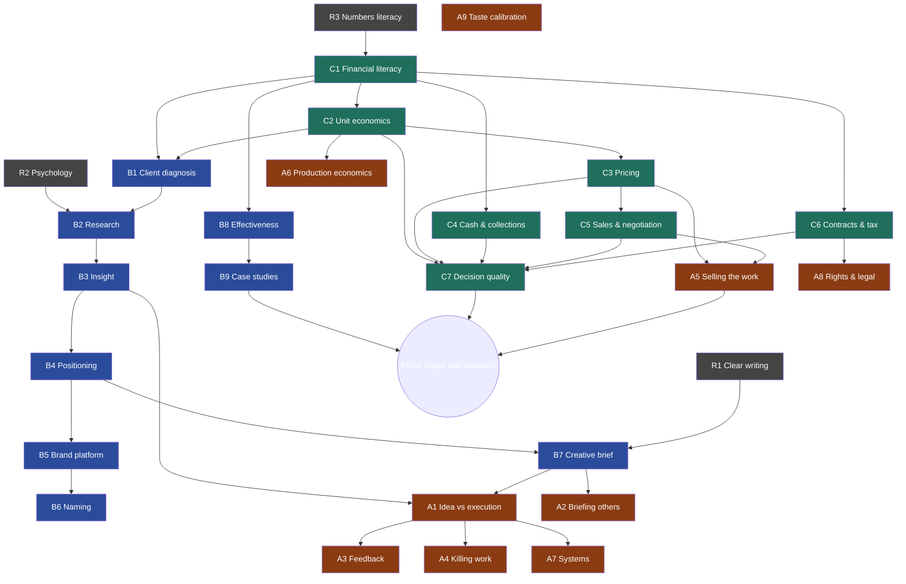

# Mastery Curriculum: Creative Direction, Brand Strategy, Business Acumen

For Svish, Elswheir Studio, Trivandrum. Written November 2026. Any Indian tax or legal points here come from memory and may be out of date. Check them with a CA or lawyer before you act on them.

---

## 0. Bottom line

- **Order of priority: Business acumen, then Brand strategy, then refining Creative direction.** Craft rarely kills a solo studio. Weak pricing, cash flow, client choice and contracts do. Your craft already sells. Your business thinking decides whether the studio lasts.
- **Strategy and business acumen are one skill seen from two sides.** Brand strategy means thinking about the *client's* business. Business acumen means thinking about *yours*. Learn them together: each strategy exercise trains both.
- **Mastery comes from decisions plus feedback, not from content.** Reading gives you vocabulary. Judgement only grows when you make calls with real stakes, write down what you expected, and compare it with what happened. Most of this plan is built around that loop.
- **Watch for this trap:** with inattentive ADHD, consuming books and courses feels like progress and avoids the discomfort of practice. Rule: **for every hour of input, spend at least two hours applying it to a live client or your own numbers.**

---

## 0.5 The skill tree (learn in dependency order)

To learn faster, learn **in dependency order** and **prioritise the shared nodes**. Some skills feed two or three tracks, so one round of practice pays off in all of them. Codes match the sections below (A = Creative Direction, B = Brand Strategy, C = Business Acumen).

### Full tree

```
ROOTS (foundations — everything grows from these)
├── R1 Clear writing (one-page thinking)
├── R2 People psychology (you have this — BA)
└── R3 Numbers literacy ──────────────────────────────┐
                                                      │
C. BUSINESS ACUMEN                                    │
├── C1 Financial literacy  ◄──────────────────────────┘
│   ├── C2 Unit economics ★ (feeds B1, A6)
│   │   └── C3 Pricing & value ★ (feeds A5)
│   │       └── C5 Sales & negotiation ★ (feeds A5)
│   ├── C4 Cash & collections
│   └── C6 Contracts, tax, compliance ★ (feeds A8)
└── C7 Decision quality & mental models  (capstone: uses C1–C6)

B. BRAND STRATEGY
├── B1 Client business diagnosis  ◄── needs C1, C2
│   └── B2 Research  ◄── needs R2
│       └── B3 Insight ★ (feeds A1)
│           └── B4 Positioning
│               ├── B5 Brand platform
│               │   └── B6 Architecture & naming
│               └── B7 Creative brief ★ (feeds A1, A2)
└── B8 Growth & effectiveness  ◄── needs C1
    └── B9 Case-study writing ★ (proof for all three tracks)

A. CREATIVE DIRECTION (refine)
├── A1 Idea vs execution  ◄── sharpened by B3, B7
│   ├── A2 Briefing others  ◄── B7
│   ├── A3 Feedback language
│   └── A4 Killing work
├── A5 Selling the work  ◄── needs C3, C5
├── A6 Production economics  ◄── needs C2
├── A7 Systems & guidelines
├── A8 Rights & legal  ◄── needs C6
└── A9 Taste calibration (daily breakdowns, runs throughout)

★ = shared node: one practice session builds two or more tracks
```

### Dependency map (renders as a diagram on GitHub)



### Critical path: the fastest route through the tree

Learn the nodes in this order. Each step unlocks the next, and the starred ones count twice.

1. **C1 Financial literacy.** Unlocks almost everything else. *(Weeks 1–3)*
2. **C2 Unit economics ★.** Do it on your own studio first, then the same lens drives B1. *(Weeks 3–5)*
3. **B1 → B2 → B3 on AIME.** Diagnosis, interviews, insight. *(Weeks 5–10)*
4. **B4 Positioning + B7 Brief ★.** This also lifts A1 and A2 straight away. *(Weeks 10–14)*
5. **C3 Pricing ★ + C5 Sales ★.** Together they unlock A5, selling the work. *(Weeks 14–20)*
6. **C4 Cash + C6 Contracts ★.** C6 also covers A8. *(Weeks 20–26)*
7. **B5, B6, B8.** Platforms, naming, effectiveness. *(Months 7–9)*
8. **B9 Case studies ★ + C7 Decision quality.** The capstones. *(Months 9–12)*
9. **A9 Taste calibration runs daily the whole time** (15 min).

### Rules for learning faster

- **One live client per node.** Don't learn a node in the abstract. Apply it to AIME, Bodhini, the Dubai client, or Elswheir itself within 7 days.
- **Shared (★) nodes first.** They are where one hour pays off two or three times.
- **Work on at most two nodes at a time:** one business node and one strategy node. Parallel tracks beyond that spread focus thin, especially with ADHD.
- **A node is "done" when you've produced its output, not when you've read about it.** Each node's output is listed in its section below. Tick it off in the tree.
- **Teach it back.** After each node, write a 200-word LinkedIn post or note explaining it in your own words. That is retrieval practice, and it doubles as Elswheir LinkedIn content.

---

## 1. The mastery loop (use it for every skill below)

1. **Predict:** before a decision or deliverable, write what you expect to happen and why. One line is enough.
2. **Do:** ship it to a real client, with real money or reputation at stake.
3. **Measure:** what actually happened? Use numbers wherever possible.
4. **Review:** where was your model wrong? Write down the rule you learned.
5. **Get critique:** one person more senior than you reviews it each month.

The tool for this is a **decision journal**: one note per decision covering date, decision, options considered, what you expect, confidence %, and a review date. Review it monthly. Over 12 months it will teach you more than any MBA module about how your own judgement fails.

---

## 2. Track A: Creative Direction (refine what you already have)

You have the eye. What separates a senior CD from a strong artist is the unglamorous work around it. Rate yourself 1–5 on each line. Work on anything rated 3 or below.

| Area | What mastery looks like | Drill |
|---|---|---|
| **Idea vs execution** | You can state the idea in one sentence with no visuals. It survives a change of medium. | For every project, write the idea as a single line *before* any frames. If it can't be written, it isn't an idea yet. |
| **Briefing others** | Partners or AI tools get it right on the first or second pass. | Keep a brief template with objective, audience, single message, tone, mandatories, references, and what *not* to do. Track how many revision rounds each brief needs. |
| **Feedback language** | Your feedback names the problem and the goal. It doesn't dictate the fix ("the hero doesn't feel premium because…"). | Rewrite your last 10 feedback notes in this form. |
| **Killing work** | You drop your own favourite idea when it misses the brief, and you do it early. | Each project, record one thing you cut and why. |
| **Selling the work** | Presentation order: problem, insight, idea, execution. You anticipate the client's three objections. | Before each pitch, write the three objections and your answers. Afterwards, record what was actually raised. |
| **Production economics** | You know what each shot, scene or asset costs to make and can trade scope against quality on the spot. | Keep a cost log per project: hours, tool credits, vendor spend, revisions. Work out cost per finished second of video. |
| **Systems and consistency** | Brand work comes with a usable guideline, so others can extend it without you. | Ship a mini style guide with every identity or campaign project. |
| **Rights and legal** | You know who owns what: AI outputs, music, fonts, stock, talent likeness, usage term and territory. | Add a usage-rights clause to every quote. Ask a lawyer about the copyright position of AI-generated work in India. It is unsettled, and clients like the Dubai couture brand will ask. |
| **Taste calibration** | You can say *why* great work works, not only that it does. | Weekly: break down one award-winning piece (Cannes, D&AD, One Show) in 5 lines covering insight, idea, craft choice, and why it fits the brand. |

---

## 3. Track B: Brand Strategy (learning)

Work through the modules in order. For each one, complete the **live-client application**: that is the real lesson.

### B1. Business-of-the-client diagnosis
- How does the client make money? What are the revenue drivers, margins, and customer lifetime value? What is the real business problem behind the marketing request?
- **Application:** for AIME, write a one-page "how AIME makes money" covering fee structure, cost of acquiring a student, conversion from enquiry to enrolment, seasonality, and competitors.

### B2. Research
- Desk research: category, competitors, cultural context.
- Qualitative: 1:1 interviews with jobs-to-be-done questions ("What were you trying to get done? What did you try before? What nearly stopped you?").
- Simple quant: survey design, sample size limits, avoiding leading questions. Your psychology training is a real advantage here.
- **Application:** interview 6–8 AIME students or parents. Synthesise patterns, tensions and surprising quotes.

### B3. Insight
- An insight is a *non-obvious human truth with tension* that the brand can resolve. "Students want good marks" is an observation, not an insight.
- **Drill:** write 20 candidate insights from your research, cut them to 3, then test each against "is it true, is it non-obvious, can the brand act on it?"

### B4. Positioning
- Target, frame of reference, point of difference, reason to believe.
- Category design versus competing within an existing category.
- **Application:** write the positioning for AIME, Bodhini and Elswheir itself.

### B5. Brand platform
- Purpose (only if real), values as behaviours, personality, voice, value proposition, message hierarchy, proof points.
- **Application:** produce a one-page platform for each live client.

### B6. Architecture and naming
- Branded house, house of brands, or endorsed. Naming criteria: distinctiveness, pronounceability across your markets, availability (trademark and domain), and connotations in the languages you sell into.
- **Application:** the dragonfly agency naming project. Write down the criteria *before* you generate names.

### B7. The creative brief
- One page: problem, audience, insight, single-minded proposition, support, mandatories.
- **Drill:** rewrite each brief until it fits on one page and a stranger could brief from it.

### B8. Growth and effectiveness
- How brands actually grow: mental and physical availability, reaching light buyers, distinctive assets (Byron Sharp's work). The balance between brand building and activation (Binet & Field).
- Measurement: leading indicators (reach, recall, search volume, enquiries) versus lagging ones (sales, share).
- **Application:** set agreed metrics with every client *before* starting, and report against them.

### B9. Case-study writing
- Problem, insight, idea, execution, results, learning. Proof with numbers is the strategist's currency.
- **Application:** one finished case per quarter.

---

## 4. Track C: Business Acumen (the thinking ability)

This means being able to see how money, people and risk move through a business, and then decide well with incomplete information. There are seven modules. Each lists the concepts, the habit, and what "mastered" looks like.

### C1. Financial literacy (start here)
- **Concepts:** revenue vs profit vs cash. Gross margin. Fixed vs variable cost. Break-even. Working capital. Receivables days. Runway.
- **Habit:** a **monthly 1-hour money review** of your P&L (income, costs, profit), cash in bank, money owed to you (with age), committed costs over the next 3 months, and runway in months.
- **Mastered when:** you can state from memory last month's revenue, margin, cash, receivables, and your monthly break-even.

### C2. Unit economics of the studio
- **Concepts:** effective earnings per hour *after the fact* (project fee ÷ actual hours, used only as a diagnostic, never as the price). Cost per project. Client acquisition cost. Client lifetime value. Revenue concentration (what share of income comes from your top client).
- **Habit:** a post-project review covering quoted vs actual effort, margin, revisions, and whether you'd take this client again.
- **Danger signal:** if one client (AIME?) is more than 40–50% of revenue, losing them is an existential risk. That is a rough rule of thumb, not a sourced figure.

### C3. Pricing and value
- **Concepts:** value-based pricing (price set against the value to the client, not your effort). Anchoring. Tiered options (good, better, best). Scope definition. Revision limits. Pricing with retainer vs project vs performance components.
- **Habit:** every proposal states the client's business value in rupees or dirhams before stating your price. Track your win rate. If you win more than ~70% of pitches, you are probably underpriced (a rough heuristic).
- **Drill:** for each new deal, write down the walk-away price before the call.

### C4. Cash and collections
- **Concepts:** advance payments (aim for 40–50% upfront on project work). Milestone billing. Payment terms. Late-payment clauses. Never letting work run ahead of payment.
- **Habit:** a weekly 10-minute receivables check. Send follow-ups on fixed days.
- **Mastered when:** money owed to you never exceeds one month of revenue.

### C5. Sales, negotiation and relationships
- **Concepts:** discovery questions (problem, impact, budget, decision process, timeline). BATNA (your best alternative if this deal fails). Trading concessions instead of giving them away. Partner economics (what AD PROPHETS and AEVORO earn from you and you from them. Write it down).
- **Habit:** after each sales call, log what they said the problem was, the budget signal, who decides, and the next step with a date.
- **Drill:** never cut price without removing scope.

### C6. Contracts, tax and compliance (India). *Get this from a CA and lawyer; the points below are from memory.*
- **GST:** registration is generally required once aggregate service turnover crosses ₹20 lakh. Exports of services (for example, the Dubai client) can be zero-rated under a LUT if they meet the "export of services" conditions.
- **Income tax:** check with your CA whether your activity qualifies for presumptive taxation (Section 44ADA) or needs regular books. Whether creative or production work counts as a "specified profession" is not straightforward.
- **TDS:** clients may deduct TDS under different sections (for example 194J vs 194C) depending on how the work is classified. Reconcile it against Form 26AS / AIS every quarter, or you will lose credit.
- **Foreign receipts:** receive them through banking channels and keep the FIRC/FIRA as proof of export.
- **Contracts:** every engagement needs scope, deliverables, revision limits, payment schedule, IP transfer on full payment only, usage rights, termination, and a liability cap. Have a lawyer draft **one master template** once. That beats improvising every time.
- **Mastered when:** you know your quarterly tax obligations and dates without looking them up.

### C7. Strategic thinking and decision quality (the core "thinking ability")
Mental models to practise until they're reflexes:

| Model | Question to ask | Example use |
|---|---|---|
| **Opportunity cost** | What am I *not* doing if I say yes? | Taking a low-fee project vs pursuing the Dubai client |
| **Base rates** | How does this usually go for people like me? | Forecasting a new revenue stream. Assume it is slower and smaller |
| **Second-order effects** | And then what? | Discounting for one client means every client hears about it |
| **Inversion / pre-mortem** | It's 12 months later and this failed. Why? | Before any big commitment |
| **Expected value** | Probability × payoff, compared across options | Choosing which pitches to invest time in |
| **Reversibility** | Is this a one-way or two-way door? | Move fast on reversible decisions, slow down on irreversible ones (hiring, equity, long contracts) |
| **Margin of safety** | What if it costs 1.5× and arrives 2× later? | Cash planning |
| **Concentration risk** | What breaks if one thing fails? | Client, partner, platform dependency |
| **Incentives** | What does each party actually gain? | Partner deals, client stakeholders |
| **Sunk cost** | Would I start this today knowing what I know? | Long-running projects or pitches that are going nowhere |

- **Habit:** run a pre-mortem plus the decision journal for every decision above roughly ₹50,000 or longer than 3 months. Pick your own threshold.
- **Habit:** a quarterly strategy review covering where revenue came from, which clients and services are most profitable, what to stop, what to double down on, and the single biggest risk.
- **Grounded vs successful:** "grounded" means you decide from evidence and protect your downside (cash buffer, diversified clients, written contracts). "Successful" means you still take sized bets on upside, like the Dubai wedge. The skill is making many small, survivable bets, not a few large ones.

---

## 5. Weekly and monthly operating rhythm

| Cadence | Time | Activity |
|---|---|---|
| Daily | 15 min | One strategy or CD breakdown (ad, case study or brand), 5 lines written |
| Weekly | 30 min | Receivables check, pipeline review, decision-journal entries |
| Weekly | 2–3 hrs | Applied practice on one live client (research, positioning, brief) |
| Monthly | 1 hr | Money review (C1) and decision-journal review |
| Monthly | 1 hr | External critique session (AD PROPHETS or a senior strategist) |
| Quarterly | Half day | Strategy review (C7) and one finished case study |

Small and consistent beats intensive and sporadic, especially with ADHD. If a week collapses, protect only the **weekly receivables check and the one applied session**.

---

## 6. 12-month roadmap

| Quarter | Business acumen | Brand strategy | Creative direction | Proof by end of quarter |
|---|---|---|---|---|
| **Q1** | C1, C4: money review habit, receivables under control. CA meeting on GST, TDS and tax regime. | B1–B3: AIME diagnosis, interviews, insight | Brief template, feedback rewrite | Monthly P&L for 3 months. AIME research synthesis. |
| **Q2** | C2, C3: unit economics, pricing reset on new proposals | B4–B5: positioning and platforms for AIME, Bodhini, Elswheir | Selling the work, three-objection drill | 3 brand platforms. New pricing used on at least 3 proposals. |
| **Q3** | C5, C6: sales log, master contract from a lawyer | B6–B7: naming project, one-page briefs | Production cost log, rights clauses | Signed master contract. First case study with numbers. |
| **Q4** | C7: quarterly strategy review, pre-mortems on big bets | B8–B9: effectiveness metrics, case writing | Taste calibration: 50+ breakdowns done | 2 case studies. Annual review: revenue, margin, concentration, win rate. |

---

## 7. Reading and sources (from memory, check editions and availability)

**Business acumen**
- *The Personal MBA*, Josh Kaufman: a broad map of business concepts
- *Financial Intelligence for Entrepreneurs*, Berman & Knight: reading the numbers
- *Profit First*, Mike Michalowicz: cash discipline for small firms
- *Never Split the Difference*, Chris Voss: negotiation
- *Poor Charlie's Almanack* / Farnam Street (fs.blog): mental models
- *Thinking in Bets*, Annie Duke: decision quality vs outcome quality
- *The Win Without Pitching Manifesto*, Blair Enns: pricing and positioning for creative firms. Directly relevant to Elswheir.

**Brand strategy**
- *Strategy Is Your Words*, Mark Pollard
- *How Brands Grow*, Byron Sharp
- *The Long and the Short of It*, Binet & Field (IPA)
- *Positioning*, Ries & Trout
- *Zag* and *The Brand Gap*, Marty Neumeier
- Effectiveness cases: Effie India, WARC, IPA Effectiveness Awards

**Creative direction**
- *Hey Whipple, Squeeze This*, Luke Sullivan
- *A Technique for Producing Ideas*, James Webb Young
- Cannes Lions, D&AD and One Show winners: case films and write-ups

Read one book at a time, and only alongside the module it supports.

---

## 8. Self-assessment: score every quarter (1–5)

| Skill | Q1 | Q2 | Q3 | Q4 |
|---|---|---|---|---|
| Know my monthly numbers from memory | | | | |
| Receivables under one month of revenue | | | | |
| Price set on value, with walk-away price defined | | | | |
| Top client under 40% of revenue | | | | |
| Write a one-page brief a stranger can use | | | | |
| Produce a brand platform from real research | | | | |
| State an idea in one sentence before visuals | | | | |
| Present the work: problem → insight → idea → execution | | | | |
| Case studies with numbers (count) | | | | |
| Decision journal kept and reviewed monthly | | | | |

The score that matters most is the **case studies with numbers** count. Clients, partners and your own confidence all rest on it.
